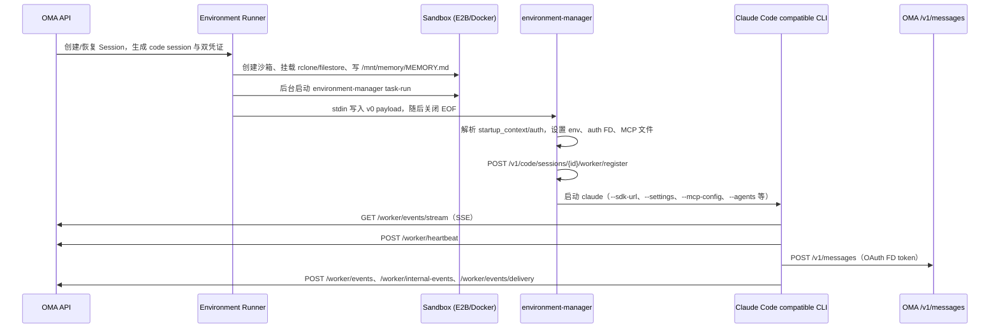

# Langcli 替换 Sandbox 内 Claude Code：深度调研

> 范围：只讨论 `environment_runner.agent_mode: sandbox` 时必须运行的沙箱内 harness。`agent_mode: brain` 短期不使用，本文只在路线对比中说明其边界。
>
> 结论先行：技术上可行，推荐“直接替换沙箱内 Claude Code 二进制”的路线，而不是 ACP 路线。协议层契合度比预调研估计的更高，因为 Langcli 源码本身就是 Claude Code 派生实现，包含同一套 CCRv2 worker 客户端、session-ingress FD 鉴权、CONNECT upstream proxy 和 `--sdk-url` headless 模式。真正的工作量集中在：把 Langcli 的多模型/自带 provider 行为钳制回 OMA 的 `/v1/messages` 代理、移除 LangRouter 硬编码 egress、对齐配置目录与技能发现、打包 Node 运行时，以及做版本/行为差分验证。

---

## 1. 结论摘要

### 1.1 可行性判断

| 判断 | 结论 |
| --- | --- |
| 沙箱内 CLI 启动契约 | 匹配。`--sdk-url` 自动进入 print + stream-json 模式，支持 `--settings`、`--mcp-config`、`--agents`、`--append-system-prompt` 等 environment-manager 会展开的参数 |
| CCRv2 worker 协议 | 匹配。Langcli 实现 `/worker`、`/worker/events`、`/worker/internal-events`、`/worker/events/stream`、`/worker/events/delivery`、`/worker/heartbeat`；`/worker/register` 由 environment-manager 调用 |
| 鉴权 FD | 匹配。同名 `CLAUDE_CODE_WEBSOCKET_AUTH_FILE_DESCRIPTOR` 与 `CLAUDE_CODE_OAUTH_TOKEN_FILE_DESCRIPTOR` |
| 模型代理 | 可匹配，但必须强制 Anthropic 协议。裸模型 ID 会触发 Langcli 的 OpenAI 协议分支，而 OMA 对 sandbox code-session 明确拒绝 `/v1/chat/completions` |
| upstream proxy | 匹配。CA 路径、CONNECT-over-WebSocket、protobuf chunk、Basic/Bearer 语义与 OMA 文档一致 |
| 权限审批 | 匹配。`can_use_tool` control_request / control_response 实现存在 |
| skills / memory / subagents | 基本匹配，但 `CLAUDE_CONFIG_DIR` 必须显式对齐到 `/root/.claude`，否则技能发现目录错误 |
| 多模型能力 | 在 sandbox 模式下不应使用。模型选择必须留在 OMA 服务端，否则会绕过凭据隔离、权限和计费 |
| ACP | 真实存在，但不是 sandbox 的现成接口。它需要替代 environment-manager 的角色，工作量高且与现有 CCRv2 重复 |
| 版本兼容 | 端点/格式与 OMA 已核对的 Claude Code 2.1.251 / 2.1.278 高度接近，但 Langcli 的基线版本未在仓库中声明，必须做差分实测 |

### 1.2 推荐路线

采用“路线 A：Langcli 作为沙箱内 harness，直接替换 `/opt/claude-code/bin/claude`”。

- OMA 侧继续负责：Agent/Session、模型代理、权限裁决、公开事件、CCRv2 worker 状态机、upstream proxy、skills/memory 挂载。
- Langcli 侧只负责：在沙箱内跑 agent loop、调用工具、通过 CCRv2 上报事件、通过 `/v1/messages` 请求模型。
- 不启用 Langcli 的 LangRouter、自带 provider 路由、ACP、自动更新和任何非 OMA 出站。

---

## 2. OMA sandbox 模式的实际运行时合同

### 2.1 启动链



关键代码：

| 事项 | 证据 |
| --- | --- |
| 默认 CLI 路径 `/opt/claude-code/bin/claude` | `internal/config/defaults.go:68` |
| `claude_path` 可配置且不限制文件名 | `internal/config/types.go:250`、`internal/environments/environment_manager.go:238` |
| environment-manager 启动参数 | `internal/environments/environment_manager.go:273-280`：`task-run --session ... --session-mode resume-cached --claude-agent-version current --claude-path ...` |
| Brain 模式才设置 `ENVRUNNER_SKIP_CLAUDE_CODE=true` | `internal/environments/environment_manager.go:259-263` |
| sandbox 模式发布 `runtime: claude_code_local` | `internal/environments/runner.go:887` |
| 真实 CLI 直连验证的入口参数 | `tests/liveworker/real_control_test.go:407-414` |

`tests/liveworker/real_control_test.go` 直接以镜像入口覆盖方式运行真实 Claude Code，参数与环境变量为：

```text
--output-format=stream-json --verbose --input-format=stream-json
--include-partial-messages --replay-user-messages
--model claude-sonnet-4-6
--sdk-url <OMA session URL>
```

```text
ANTHROPIC_BASE_URL=<OMA API>
CLAUDE_CODE_SESSION_ACCESS_TOKEN=<session ingress>
CLAUDE_CODE_WORKER_EPOCH=<epoch>
CLAUDE_CODE_USE_CCR_V2=1
CLAUDE_CODE_POST_FOR_SESSION_INGRESS_V2=1
CLAUDE_CODE_REMOTE=true
CLAUDE_CODE_REMOTE_SESSION_ID=<code session id>
CLAUDE_CODE_DISABLE_NONESSENTIAL_TRAFFIC=1
CLAUDE_CODE_DISABLE_OFFICIAL_MARKETPLACE_AUTOINSTALL=1
CLAUDE_CODE_ENABLE_BACKGROUND_PLUGIN_REFRESH=0
```

这段测试是当前仓库内对“CLI 启动契约”最直接的证据。environment-manager 自身是外部二进制，无法在仓库内完全审计；但它必须产生与该测试等价的 CLI 调用，否则现有 Claude Code 无法工作。

### 2.2 environment-manager 注入的 payload

`internal/environments/environment_manager.go:129-215` 构造 v0 payload：

- `startup_context.api_base_url`：sandbox 可访问的 OMA API 地址。
- `startup_context.use_code_sessions=true`、`session_id`。
- `startup_context.claude_code_args`：至少包含 `settings=/root/.claude/launcher-settings.json`，并可能包含 `mcp-config`、`agents`。
- `startup_context.environment_variables`：
  - `CLAUDE_CODE_REMOTE=true`
  - `CLAUDE_CODE_POST_FOR_SESSION_INGRESS_V2=1`
  - `CLAUDE_CODE_USE_CCR_V2=1`
  - `CLAUDE_CODE_WORKER_EPOCH=<epoch>`
  - `CLAUDE_CODE_INCLUDE_PARTIAL_MESSAGES=true`
  - `CLAUDE_CODE_DISABLE_TERMINAL_TITLE=1`
  - `CCR_UPSTREAM_PROXY_ENABLED=1`
  - `ANTHROPIC_MODEL`、`ANTHROPIC_DEFAULT_OPUS_MODEL`、`ANTHROPIC_DEFAULT_SONNET_MODEL`、`ANTHROPIC_DEFAULT_HAIKU_MODEL` 全部设为 Agent 保存的模型 ID（新数据为完整 ID；`internal/environments/environment_manager.go:217-228`）
  - 删除 `CLAUDE_CODE_SESSION_ACCESS_TOKEN`，避免遮蔽 WebSocket auth FD（`:171`）
- `auth` 两种凭证：
  - `session_ingress`：Ed25519 `sk-ant-si-<JWT>`，通过 WebSocket auth FD 使用。
  - `anthropic_oauth`：`sk-ant-oat01-...`，通过 OAuth FD 访问 `/v1/messages`。
- 上游 Provider Key 不进入 sandbox，`ANTHROPIC_BASE_URL` 始终指向 OMA（`docs/design/be/ccrv2/upstream-proxy-and-model-runtime.md:30-82`）。

### 2.3 CLI 必须实现的端点

`internal/codesessions/routes.go:64-83` 注册的 worker 子路由：

| 端点 | 用途 | 关键约束 |
| --- | --- | --- |
| `POST /worker/register` | 环境管理器注册 worker、建立首个 lease、递增 epoch | environment-manager 调用，不是 CLI 调用 |
| `PUT /worker` | 上报 worker 状态与 external metadata | 必须带当前 `worker_epoch` |
| `GET /worker` | 恢复前一个 worker 的 metadata | 只读 |
| `GET /worker/events/stream` | SSE 读取入站 `client_event` | 支持 `worker_epoch` 校验 |
| `POST /worker/events` | 上报公开输出事件 | 事件数组、epoch、UUID 幂等 |
| `POST /worker/events/delivery` | received / processing / processed ACK | 最多 64 项 |
| `POST /worker/internal-events` | transcript JSONL 持久化，供 resume | `payload.type` 限定 user/assistant/attachment/system |
| `GET /worker/internal-events` | resume 读取 transcript | 不要求 epoch |
| `POST /worker/heartbeat` | 续 lease | 默认 20 秒 |
| `POST /worker/diagnostics` | 诊断日志 | epoch/lease |
| `POST /worker/otlp/v1/{logs,traces}` | OTLP | 可选 |
| `POST /worker/events` 中的 `control_request` | 工具权限审批 | OMA 计算 allow/ask/deny |

另有两个运行时端点：

- `GET /v1/code/upstreamproxy/ca-cert` 与 `GET /v1/code/upstreamproxy/ws`（`internal/codesessions/routes.go:40-42`）。
- `POST /v1/messages`（模型代理，`docs/design/be/messages-proxy.md`）。

注意：`GET /v2/sessions/{id}` 与 `/v2/sessions/{id}/skills`（`internal/codesessions/routes.go:29-31`）主要供 Brain/DSH 或 skills API 使用；Claude Code 沙箱内 CLI 不从这些端点读取 skills，skills 通过 `/root/.claude/skills` 只读挂载发现。

### 2.4 权限与工具审批

`docs/design/be/managed-agent-claude-code-permission-bridge.md` 定义了 sandbox 的权限主路径：

1. Claude Code 执行工具前发出 `control_request` / `subtype=can_use_tool`。
2. OMA 从 Agent snapshot 计算 effective policy。
3. allow/deny 直接回 `control_response`；ask 投影为公开 `agent.tool_use` / `requires_action`，等待客户端确认。
4. `WebSearch`/`WebFetch` 归一化为 `web_search`/`web_fetch`；未知工具在 `resolveToolPermissionFromAgentSnapshot` 的 default 分支返回 `deny`，`ask_user_question` 未显式配置时也默认 `deny`（`internal/codesessions/tool_permissions.go:188-207`）。

### 2.5 skills、memory、subagents、MCP

| 能力 | OMA 合同 | 证据 |
| --- | --- | --- |
| skills | Filestore `/skills` 只读挂载到 `/root/.claude/skills`；技能目录名即技能名 | `docs/design/be/managed-agent-skills-runtime.md:12,31,79-106` |
| memory | `/mnt/memory/{slug}` + `/mnt/memory/MEMORY.md`，模型通过普通文件工具读写 | `docs/design/be/memory-store.md:9,60-65,100-147` |
| transcripts | `/worker/internal-events` 保存可写回 Claude Code transcript JSONL 的消息 | `docs/design/be/ccrv2/ccr-v2-api-worker-internal-events.md:1-60` |
| subagents | `--agents <json>`，包含 `description/prompt/model/skills/mcpServers` | `internal/environments/subagents.go`；`docs/design/be/subagent-delegation.md` |
| MCP | `--mcp-config /tmp/managed-agent-mcp-config.json`；Tunnel MCP 使用 HTTP + session ingress header；server 配置可带 `tools[]` 的 `enabled`/`permission_policy` | `internal/environments/managed_agent_mcp_config.go`；`internal/codesessions/mcp_runtime_config.go`；`internal/environments/environment_manager_test.go:490-520` |
| 文件 | `/mnt/user-data/outputs`、`/mnt/session/uploads`、`/mnt/transcripts` 等固定挂载 | `docs/design/be/e2b-sandbox-image-contract.md` |

---

## 3. Langcli 现状与协议契合度

### 3.1 CLI 启动模式

| 模式 | 入口 | 与 sandbox 的关系 |
| --- | --- | --- |
| 交互式 REPL | `src/main.tsx` 默认 | 不适用 |
| `-p/--print` + stream-json | `src/cli/print.ts` | headless 基础 |
| `--sdk-url <url>` | `src/main.tsx:1954-1990`、`src/cli/print.ts:5280-5282` | 与 environment-manager 的启动方式一致 |
| `--acp` | `src/entrypoints/cli.tsx:105-106`、`src/services/acp/entry.ts` | 协议不同，见第 5 节 |

关键行为：

- `--sdk-url` 会自动设置 `inputFormat=stream-json`、`outputFormat=stream-json`、`print=true`、`verbose=true`（`src/main.tsx:1968-1985`）。因此 environment-manager 不显式传 `--print` 也可以。
- 带 `--sdk-url` 时跳过 `--session-id` 的 UUID 校验，允许 `cse_...` 形式的服务端 ID（`src/main.tsx:2022-2025`）。
- `--sdk-url` 模式使用 `RemoteIO`（`src/cli/print.ts:5280-5282`），通过传输层读写 JSONL 事件，而不是 stdin/stdout。
- Langcli 自己的 bridge 在被要求启动子会话时，也使用同一组参数：`--print --sdk-url ... --session-id ... --input-format stream-json --output-format stream-json --replay-user-messages`（`src/bridge/sessionRunner.ts:288-325`），可作为这些 flag 组合可用的旁证。
- `--settings`、`--mcp-config`、`--agents`、`--system-prompt`、`--append-system-prompt` 均存在（`src/main.tsx:1487-1520,1658-1666`）。
- `--agents` 会解析 JSON 并合并到 agent definitions（`src/main.tsx:1818-1835,2927-2941`）。

### 3.2 CCRv2 worker 协议

Langcli 的 `src/cli/transports/ccrClient.ts` 与 OMA 服务端实现是同一条协议线：

| 能力 | Langcli 证据 | OMA 证据 |
| --- | --- | --- |
| 初始化 epoch | `initialize()` 读取 `CLAUDE_CODE_WORKER_EPOCH`，PUT `/worker`（`:459-540`） | `docs/design/be/ccrv2/ccr-v2-api-worker-state.md` |
| 公开事件 | POST `/worker/events`，批量最多 100 个 / 10 MiB（`:371`） | `internal/codesessions/ingress.go` worker events handler |
| transcript | POST `/worker/internal-events`（`:394`），`writeInternalEvent` 先写 `type` 再展开 payload（`:793-814`） | `docs/design/be/ccrv2/ccr-v2-api-worker-internal-events.md:20-60` |
| delivery ACK | POST `/worker/events/delivery`，最多 64 项（`:419`） | 同名文档 |
| SSE 读取 | `transportUtils.ts:25-33` 在 `--sdk-url` 后追加 `/worker/events/stream` | `internal/codesessions/routes.go` |
| 心跳 | POST `/worker/heartbeat`，默认 20 秒（`:712`） | `worker-heartbeat-server-implementation.md` |
| resume | GET `/worker/internal-events` 与 subagent 版本（`:838-860`） | 同名文档 |
| 状态恢复 | GET `/worker`（`:540`） | `worker-get-api.md` |

值得注意的是，OMA 的内部事件文档直接以 `superduck-code` 的 `src/cli/transports/ccrClient.ts` 作为协议来源（`docs/design/be/ccrv2/ccr-v2-api-worker-internal-events.md:24-34`）。Langcli 的同类文件与这些描述逐项吻合，说明协议不是“重新适配”，而是同源实现。

### 3.3 鉴权

| 凭证 | Langcli | OMA |
| --- | --- | --- |
| WebSocket/session ingress | `CLAUDE_CODE_WEBSOCKET_AUTH_FILE_DESCRIPTOR`，回退到 `/home/claude/.claude/remote/.session_ingress_token`（`src/utils/sessionIngressAuth.ts:25-115`） | `CLAUDE_CODE_WEBSOCKET_AUTH_FILE_DESCRIPTOR`（`docs/design/be/ccrv2/upstream-proxy-and-model-runtime.md:81`） |
| OAuth `/v1/messages` | `CLAUDE_CODE_OAUTH_TOKEN_FILE_DESCRIPTOR`，回退到 `.oauth_token`（`src/utils/authFileDescriptor.ts:170-195`） | `CLAUDE_CODE_OAUTH_TOKEN_FILE_DESCRIPTOR`（同文档 `:82`） |
| OAuth token 注入 Anthropic client | `getClaudeAIOAuthTokens()` 优先读 FD（`src/utils/auth.ts:1264-1285`），client 用 `authToken`（`src/services/api/client.ts:319-330`） | `/v1/messages` 接受 Bearer lifecycle token |

### 3.4 upstream proxy

Langcli 的 `src/upstreamproxy/` 与 OMA 的服务端实现是同一套协议：

- 仅在 `CLAUDE_CODE_REMOTE=true` 且 `CCR_UPSTREAM_PROXY_ENABLED` 为真时启用。
- 读取 `CLAUDE_CODE_REMOTE_SESSION_ID`，从 `/run/ccr/session_token` 读取 token。
- `GET {ANTHROPIC_BASE_URL}/v1/code/upstreamproxy/ca-cert` 下载 CA，合并系统 CA。
- 启动本地 CONNECT 监听，CONNECT head 带 `Proxy-Authorization: Basic base64(session_id:token)`。
- WebSocket 使用 `Content-Type: application/proto`，载荷是单字段 `UpstreamProxyChunk { bytes data = 1; }`。
- 成功后删除 token 文件，并把 `HTTPS_PROXY`、`SSL_CERT_FILE`、`NODE_EXTRA_CA_CERTS` 等注入子进程环境。

证据：`src/upstreamproxy/upstreamproxy.ts:85-150,254-276`、`src/upstreamproxy/relay.ts:350-390`；OMA 侧见 `docs/design/be/ccrv2/upstream-proxy-and-model-runtime.md:1-180`。

### 3.5 模型与 provider 路由

这是最容易低估、也最可能直接导致 sandbox 会话不可用的部分。

Langcli 的选择逻辑：

1. `getUserSpecifiedModelSetting()` 优先 `ANTHROPIC_MODEL`，其次 `settings.model`（`src/utils/model/model.ts:104-125`）。
2. `parseUserSpecifiedModel()` 对内置别名做映射，未命中的字符串原样返回（`src/utils/model/model.ts:260-340`）。
3. `getAPIProvider(model)`：
   - 如果 model 在 `CANONICAL_ID_TO_PROTOCOL` 中，非 `claude` 的内置模型返回 `openai`（`src/utils/model/providers.ts:44-48`、`src/utils/model/configs.ts:66-80`）。
   - 否则读取 `settings.modelType`、`CLAUDE_CODE_USE_OPENAI/GEMINI/GROK` 等。
   - 默认返回 `firstParty`（Anthropic SDK）。
4. OpenAI 协议路径会请求 `{ANTHROPIC_BASE_URL}/v1/chat/completions`（`src/services/api/openai/client.ts:68-82`）。

OMA 的模型 ID 规则：

- 新数据使用完整 ID `{slug}/{upstream_model_id}`，例如 `oma/kimi-k2.5`（`docs/design/be/messages-proxy.md:14-23`）。
- 完整 ID 不命中 Langcli 的内置 canonical 列表，因此会落到 `firstParty`，正确走 `/v1/messages`。
- 但 OMA 仍长期兼容历史裸 ID，例如 `kimi-k2.5`（`docs/design/be/messages-proxy.md:43`）；`internal/environments/environment_manager_test.go:213` 的 sandbox payload 测试也直接使用 `"model":"kimi-k2.5"`。
- 一旦模型 ID 是 `kimi-k2.5`、`deepseek-flash`、`glm-5.2` 等 Langcli 内置非 Claude 名称，Langcli 会走 OpenAI 协议。
- OMA 的 `/v1/chat/completions` **只接受 Brain claim 会话**；sandbox code session 会被拒绝（`internal/messages/chat.go:13-27`、`docs/design/be/messages-proxy.md:243-250`）。

因此：

> 在 sandbox 模式下，Langcli 必须被强制为 Anthropic Messages 协议，不能依赖“模型 ID 恰好不是内置名”这种偶然性。

另外，`settings.modelType: openai`、`CLAUDE_CODE_USE_OPENAI`、`settings.modelProviders` 都可能改变路由。镜像内的用户设置或登录状态必须清理，或者通过补丁在 OMA 模式下忽略这些开关。

### 3.6 ACP

Langcli 的 ACP 是真实实现，不是占位：

- `--acp` 入口：`src/entrypoints/cli.tsx:105-106` 调用 `src/services/acp/entry.ts`。
- `AcpAgent` 实现 initialize、newSession、load/resume/fork/close/list、prompt、cancel、setSessionMode、setSessionModel、setSessionConfigOption（`src/services/acp/agent.ts:166-200,243-444,455-600`）。
- 每个 ACP session 内部创建 `QueryEngine`，工具在本地执行（`agent.ts:520-545`）。
- MCP server 由 ACP client 在 `NewSessionRequest.mcpServers` 中传入。
- 权限通过 ACP `requestPermission()` 转给 client（`src/services/acp/permissions.ts`）。
- 事件映射 `SDKMessage → ACP SessionUpdate`（`src/services/acp/bridge.ts`）。

但它与 sandbox 合同的关键差距：

| 需求 | ACP 现状 |
| --- | --- |
| CCRv2 worker 协议 | 无 |
| `/worker/events`、`/worker/internal-events`、heartbeat | 无 |
| OMA 的 `/v1/messages` lifecycle token | 可以借 `ANTHROPIC_BASE_URL` + FD，但 ACP 进程本身不处理 |
| environment-manager 的 `--settings`/`--mcp-config`/`--agents` | ACP 入口不解析这些 CLI 参数 |
| Agent system prompt / append system prompt | `NewSessionRequest` 没有对应字段；`_meta` 只处理 permissionMode |
| Agent tools 配置 | 无 ACP 映射 |
| subagents / `--agents` / skills 引用 | 无 ACP 映射（只能依赖本地目录自动发现） |
| 模型目录 | `getModelOptions()` 是 Langcli 内置模型，不是 OMA 模型目录 |
| session 持久化 | 本地 session，不是 OMA transcript/CCRv2 |

所以 ACP 不能直接作为 environment-manager 的 `--claude-path`。如果走 ACP，必须新写一个沙箱内 supervisor：它既要扮演 environment-manager 的启动/凭证/文件系统角色，又要实现 ACP client 和 OMA worker 事件映射。这等于重复实现 Langcli 已经自带的 CCRv2 客户端，工作量高于路线 A。

ACP 的合理用途：

- 未来如果做 Brain-in-sandbox 或外部 harness 协议，可以复用 ACP 的结构化事件与权限模型。
- IDE/第三方客户端集成。
- 不适合当前 `agent_mode=sandbox` 的二进制替换目标。

### 3.7 打包与运行时

`build.ts` 已经覆盖了“把代码打成可运行产物”这件事的大部分：

- `Bun.build` 以 `src/entrypoints/cli.tsx` 为入口、`target: node` 输出 `dist/cli.js`（约 27 MiB）。
- 递归复制 `vendor/` 到 `dist/vendor/`，包含 Linux x64/arm64 的 ripgrep；`src/utils/ripgrep.ts:58` 通过 `__dirname/vendor/ripgrep` 定位它。
- 把 Bun 专用的 `import.meta.require` 替换为 Node 兼容的 `createRequire`（`build.ts:52-69`）。
- 实测 `Bun.build` 产出的 `dist/cli.js` 带 `#!/usr/bin/env node` 且可直接执行；在本机 macOS 上，`copyFile` 也保留了 vendor 可执行位。Linux 镜像构建时仍应复核一次权限位。
- 构建时硬编码 `process.env.DISABLE_TELEMETRY = "1"`（`build.ts:20`），dist 版本默认关闭 1P telemetry。

但仍然有三件事不属于 `build.ts` 的职责：

1. **Node 20 运行时**：产物仍是 `#!/usr/bin/env node` 脚本，镜像必须提供 Node `>=20`（`package.json` engines）。如果要单文件无 Node 依赖，需要额外采用 `bun build --compile`，当前构建脚本没有做。
2. **镜像布局**：必须复制整个 `dist/`（`cli.js` + `vendor/`），不能只复制 `cli.js`。可以直接把 `environment_runner.claude_path` 指向 `/opt/langcli/dist/cli.js`，也可以在该路径放 wrapper 或 symlink 到 `/opt/claude-code/bin/claude`。Node 会把入口 symlink 解析为真实路径，因此 `__dirname/vendor` 仍能命中；但为了显式控制环境和路径，wrapper 更稳。
3. **sandbox 环境加固**：`CLAUDE_CONFIG_DIR`、`DISABLE_AUTOUPDATER`、`CLAUDE_CODE_PROVIDER_MANAGED_BY_HOST` 需要在启动前注入；这些不是 `build.ts` 能解决的，应放在 environment-manager payload、launcher 环境或 wrapper 中。

另外，`scripts/defines.ts:10` 把 `MACRO.VERSION` 硬编码为 `0.1.53`，不是从 `package.json` 读取；发布时容易出现包版本与 `--version` 输出不一致，需要在发布流程中校验。

---

## 4. 兼容性矩阵

| 合同项 | OMA 要求 | Langcli 现状 | 判断与动作 |
| --- | --- | --- | --- |
| CLI 路径与可执行性 | `/opt/claude-code/bin/claude` 或 `claude_path` 指向可执行文件 | `dist/cli.js` 可直接执行；需 Node 20 + 整个 `dist/` | 改 `claude_path`、wrapper 或 symlink；注入 env |
| `--version` | environment-manager `current` 模式读取 | 输出 `0.1.53 (Claude Code)` | 需实测解析规则；必要时 wrapper 输出兼容版本 |
| `--sdk-url` | 进入 remote/CCRv2 模式 | 自动 print + stream-json | 匹配 |
| `--settings` | `/root/.claude/launcher-settings.json` | 支持 flag settings | 匹配 |
| `--mcp-config` | `/tmp/managed-agent-mcp-config.json` | 支持多配置、http/sse/stdio | 基本匹配 |
| `--agents` | JSON subagent definitions | 支持并合并 | 匹配 |
| system / append prompt | 来自 startup context | 支持 | 匹配 |
| env `CLAUDE_CODE_*` | 见 2.2 | 支持大部分 | 匹配 |
| `DISABLE_AUTOUPDATER` | 建议禁用 | 支持；OMA 当前未设置 | 增加 |
| `CLAUDE_CODE_PROVIDER_MANAGED_BY_HOST` | 防止镜像设置改路由 | 支持；OMA 当前未设置 | 增加 |
| `CLAUDE_CONFIG_DIR` | 技能在 `/root/.claude/skills` | 默认 `~/.langcli` | **必须设置 `/root/.claude` 或补丁** |
| worker register | environment-manager 做 | CLI 只读 epoch | 匹配 |
| SSE `/worker/events/stream` | 必须 | 由 `--sdk-url` 派生 | 匹配 |
| `/worker/events` | 公开事件 | 实现 | 匹配 |
| `/worker/internal-events` | transcript resume | 实现 | 匹配 |
| `/worker/events/delivery` | 三态 ACK | 实现 | 匹配 |
| `/worker/heartbeat` | 20 秒 | 实现 | 匹配 |
| `/worker` GET/PUT | 状态与 metadata | 实现 | 匹配 |
| upstream proxy CA | `/v1/code/upstreamproxy/ca-cert` | 实现 | 匹配 |
| upstream proxy WS | CONNECT-over-WebSocket | 实现 | 匹配 |
| `/v1/messages` 鉴权 | OAuth FD Bearer | FD 优先 | 匹配 |
| 模型路由 | 必须走 Anthropic Messages | 内置非 Claude ID 会走 OpenAI | **必须强制 firstParty** |
| MCP `tools[]` 静态权限提示 | `enabled`/`permission_policy` | zod schema 未声明 `tools`，会被忽略 | 运行期仍按策略裁决；建议补丁或接受噪声 |
| 内置工具面 | OMA 只映射 9 项 + `get_port_url` | Langcli 暴露更多工具 | 需差分验证；未知工具默认 deny |
| 权限 `can_use_tool` | control_request/response | 实现 | 匹配 |
| skills 发现 | `/root/.claude/skills` | 用户目录随 `CLAUDE_CONFIG_DIR` | **配置对齐后匹配** |
| memory | `/mnt/memory` + MEMORY.md | 普通文件工具可读写 | 匹配 |
| subagents | `--agents` + SendMessage 线程 | 均存在 | 匹配 |
| WebSearch | OMA 权限与网络策略 | 硬编码 `api.langrouter.ai` | **不兼容** |
| WebFetch | 客户端工具 + OMA 权限 | 先 LangRouter，再本地直连 | **需改** |
| 遥测/egress | 只允许 OMA 与策略内主机 | 有 LangRouter 拉取；自动更新/插件需禁用 | **需加固** |
| 自动更新 | 不应发生 | 受 `DISABLE_AUTOUPDATER` 控制 | 增加 |
| 插件市场 | 不应后台刷新 | 受 `DISABLE_AUTOUPDATER`/官方市场开关控制 | 增加 `DISABLE_AUTOUPDATER` |
| 版本兼容 | 已核对 2.1.251 / 2.1.278 | 基线未声明 | 必须差分实测 |

---

## 5. 关键缺口与风险（按优先级）

### P0-1：模型协议路由会导致会话直接失败

风险链路：

1. Agent/Session 的模型 ID 是历史裸 ID（例如 `kimi-k2.5`）。
2. OMA 在 payload 中把它写入 `ANTHROPIC_MODEL`、`ANTHROPIC_DEFAULT_*`。
3. Langcli 的 `getAPIProvider` 命中内置非 Claude 模型 → `openai`。
4. Langcli 请求 `{ANTHROPIC_BASE_URL}/v1/chat/completions`。
5. OMA 的 `ChatCompletions` 要求 `worker_transport == "claim"`，sandbox 会话被拒绝，返回 400。

处理方式（推荐同时做）：

- **Langcli 补丁**：在 `CLAUDE_CODE_REMOTE` 或新增 `OMA_SANDBOX=1` 时，`getAPIProvider` 无条件返回 `firstParty`，忽略 canonical OpenAI 模型、`modelType`、`CLAUDE_CODE_USE_OPENAI`、`modelProviders`。
- **OMA 侧防御**：启动前校验 code session 的模型 ID 必须是可解析的完整 ID；对历史裸 ID 做规范化或拒绝启动。
- **镜像清理**：删除 `/root/.claude/settings.json`、`/root/.langcli`、登录状态，避免 `modelType`/`modelProviders` 污染。
- **回归测试**：分别用 `oma/kimi-k2.5`、裸 `kimi-k2.5`、`deepseek-flash` 启动，断言只出现 `/v1/messages`，不出现 `/v1/chat/completions`。

**补充：不建议直接把 OMA 模型名全部改成 Langcli/LangRouter 名**

改名本身不能解决模型路由问题，取决于请求是否仍经过 OMA：

| 方案 | 结果 |
| --- | --- |
| OMA 公共模型名改为 `kimi-k2.5` 等裸名，请求仍走 OMA `/v1/messages` | Langcli 命中 `CANONICAL_ID_TO_PROTOCOL`，改走 OpenAI 协议，请求 `/v1/chat/completions`；OMA 拒绝 sandbox code session。仍然需要“强制 firstParty”补丁，改名前后的差别只是让问题更容易触发 |
| OMA 公共模型名改为 LangRouter 名，Langcli 直连 LangRouter | 模型名对齐了，但进入 BYOK/直连架构：`ANTHROPIC_BASE_URL` 冲突、OMA 模型代理/计费/预算/观测/文件引用丢失、key 进入 sandbox。改名不是主要成本，架构变化才是 |
| 保留 `{slug}/{upstream}`，OMA 内部把 LangRouter 作为 Provider | Langcli 看到 `langrouter/kimi-k2.5`，不命中 canonical，走 `/v1/messages`；OMA 转发时去掉 slug，LangRouter 收到 `kimi-k2.5`。这是最小改动且不破坏公共 ID |

不建议把公共模型 ID 直接绑定到 Langcli 的别名表，原因：

- Langcli 的 `kimi-k2.5`、`deepseek-flash`、`glm-5.2` 是 CLI 别名，不是稳定的上游模型 ID；Langcli 的 CHANGELOG 会随版本改模型名和别名，OMA 的持久化模型 ID 会跟着漂移。
- OMA 的 `{slug}/{upstream_model_id}` 用于区分不同 Provider 下的同名模型；改成裸名会重新引入歧义。
- 模型 ID 分布在 agents、agent_versions、sessions.agent_snapshot、code_sessions、thread 快照、deployment、batches、usage/billing、公开 API 和 SDK 示例中；全量改名是一次破坏性迁移，而收益只是“名字看起来一致”。
- 如果只是希望控制台展示 LangRouter 的名字，可以增加 display alias，不需要改持久化 ID 和公共 API。

推荐：保留 OMA 的完整 ID；用 slug 命名空间表达 Provider（例如 `langrouter/kimi-k2.5`）；在 OMA 模型代理内部解析到 LangRouter 的上游 ID；同时在 sandbox 模式下强制 Langcli 使用 Anthropic 协议，不依赖模型名是否命中 canonical 表。

### P0-2：LangRouter 硬编码出站与 Web 工具不兼容

> 注意：如果部署方明确把 LangRouter 作为 sandbox 的模型 + Web provider，并让 `ANTHROPIC_BASE_URL` 指向 `https://api.langrouter.ai`，那么这不是“provider 选择错误”，而是 BYO LangRouter 架构。此时 WebSearch/WebFetch 走 LangRouter 是预期行为；本节的问题收缩为 OMA 策略/计费/审计旁路，以及下文 `ANTHROPIC_BASE_URL` 双用、附件解析和 key 注入问题。

证据：

- `WebSearchTool` 的 adapter 工厂永远返回 `ApiSearchAdapter`（`src/tools/WebSearchTool/adapters/index.ts`）。
- `ApiSearchAdapter` 固定 POST `https://api.langrouter.ai/v1/web_search`（`src/tools/WebSearchTool/adapters/apiAdapter.ts:11,67`）。
- `WebFetchTool` 固定 POST `https://api.langrouter.ai/v1/web_fetch`（`src/tools/WebFetchTool/WebFetchTool.ts:26,65`），失败后才回退本地直连。
- 两者使用 `ANTHROPIC_AUTH_TOKEN` 或 apiKeyHelper 作为 Bearer（`apiAdapter.ts:25-29`）。
- `refreshModelCapabilities()` 固定 GET `https://api.langrouter.ai/v1/models`，并且 `isEssentialTrafficOnly()` 检查被注释掉（`src/utils/model/modelCapabilities.ts:45-50,84-90`）。

后果：

- 沙箱内没有 LangRouter token 时，WebSearch 直接报 “No API token available for web search”。
- 如果有 `ANTHROPIC_AUTH_TOKEN`，会把 OMA 凭证发给第三方域名。
- 即使网络策略拦截，也会产生失败请求和启动噪声。
- OMA 的 `/v2/ccr-sessions/{id}/web/search|fetch` 当前只由 Brain 使用；sandbox 的真实 Claude Code 不调用它们，因此 LangRouter 替换不会自动落到 OMA。

**为什么不能只靠“放开 E2B 出站”解决**：

1. **默认没有凭证，功能仍然是坏的**：Langcli 用 `ANTHROPIC_AUTH_TOKEN` 或 apiKeyHelper 作为 LangRouter Bearer。OMA sandbox 使用 OAuth FD，不设置 `ANTHROPIC_AUTH_TOKEN`，所以 WebSearch 会直接报无 token；放开网络也不会让它自动获得 LangRouter 凭证。
2. **补上凭证就是凭证外泄**：如果把 OMA/OAuth token 写进 `ANTHROPIC_AUTH_TOKEN` 让 LangRouter 调用成功，就是把生命周期受限的 OMA 凭证发送给第三方域名，违反 OMA 的凭据边界。
3. **绕过 OMA 的工具策略与服务端防护**：OMA 的 Web 工具合同包含环境 `allowed_hosts`、工具级 `allowed_domains`/`blocked_domains`、内容预算、SSRF/重定向校验、审计与计费；LangRouter 调用和 WebFetch 的本地直连都不经过这些服务端检查。放开出站相当于把这些限制一起放弃。
4. **绕过计量与计费**：OMA 的 `/v2/ccr-sessions/{id}/web/search|fetch` 是计量和计费入口；直接请求 LangRouter 不会产生 OMA 的搜索用量和账单记录。
5. **第三方依赖与可用性**：`refreshModelCapabilities()` 还会在启动后访问 `https://api.langrouter.ai/v1/models`，且该 fetch 没有超时；放开出站只是把“被网络策略拒绝”变成“依赖 LangRouter 可用性和延迟”，同时把模型能力缓存变成 LangRouter 的数据。
6. **多租户/合规边界**：搜索词、目标 URL、页面内容会离开 OMA 的租户边界；即使部署方愿意放开出站，也不能默认所有租户都接受第三方检索服务。

建议：

- 方案 A（最小）：禁用 Langcli 的 WebSearch/WebFetch，或在 OMA 模式下把它们从工具列表中移除，由 Agent 配置决定。
- 方案 B（推荐）：把两个 adapter 改为调用 OMA 的 session runtime Web 端点（带 session ingress token 与线程 header），让 OMA 统一执行域名策略、内容预算与计费。
- 方案 C：恢复到上游 Anthropic server-tool 行为，但这会重新引入对 provider 能力的依赖。
- 无论哪种，都必须删除 `api.langrouter.ai` 硬编码，并移除被注释掉的 privacy guard。放开 E2B 出站不是替代方案，只是把可观测的失败换成不可控的第三方依赖和凭证暴露。

**补充：如果每个 sandbox 使用“用户独享 API key”**

需要先区分这把 key 的用途：

| key 用途 | 效果 | 仍然存在的问题 |
| --- | --- | --- |
| 仅用于 LangRouter WebSearch/WebFetch | 解决“没有 LangRouter token”和“OMA 凭证发给第三方”的问题（因为 key 属于用户/LangRouter） | OMA 的环境/工具域名策略、内容预算、SSRF/重定向校验、计量计费、审计和租户数据边界仍被绕过；key 进入 sandbox 后仍可被工具读取/外泄，需要严格的 per-sandbox 注入、轮换和审计 |
| 用于模型请求（Langcli 直连 LangRouter 或其他 provider） | 可以让 Langcli 不经过 OMA `/v1/messages` | OMA 失去 provider 隔离、模型目录一致性、usage/budget、模型请求观测、文件引用解析、错误转换和 per-agent 模型约束；这实际上变成“BYOK sandbox”架构，需要单独定义产品和计费合同 |
| 是 OMA API key，用于 OMA `/v1/messages` | 可以作为 OMA 模型代理的鉴权 | 它不是 LangRouter key，WebSearch 仍然不能工作；而且把长期用户 API key 放进 sandbox，比 lifecycle-bound OAuth FD 更差 |

如果目标是保留 OMA 的 Web 工具策略与计费，正确做法不是把 LangRouter key 放进 sandbox，而是让 key 留在 OMA/Vault 侧，由 OMA 执行 Web 工具。若产品上确实要支持“用户自带 LangRouter key”，应把它作为 OMA 的 provider/credential 配置，在 OMA 服务端使用，而不是下发给沙箱内的 Langcli。

**如果用户独享 key 同时用于模型请求和 Web 工具，且 `ANTHROPIC_BASE_URL` 已指向 LangRouter**

先确认两个实现细节：

- Langcli 的 WebSearch/WebFetch 读取的是 `ANTHROPIC_AUTH_TOKEN` 或 apiKeyHelper，不读取 `ANTHROPIC_API_KEY`（`src/tools/WebSearchTool/adapters/apiAdapter.ts:25-29`、`src/tools/WebFetchTool/WebFetchTool.ts:46-50`）。因此用户 key 必须注入为 `ANTHROPIC_AUTH_TOKEN`，否则 WebSearch 仍会报无 token。
- OMA 当前会注入 `anthropic_oauth` FD。如果该 FD 仍存在，Langcli 可能把它当作 Claude.ai 订阅认证，导致模型请求不使用用户 key。直连模式应移除 `anthropic_oauth` auth，或确保 `ANTHROPIC_AUTH_TOKEN` 的优先级并做实测。

这时问题不再是“key 归谁”，而是“请求路径是否还经过 OMA”。直接让 Langcli 用这把 key 请求 LangRouter 会产生一个关键的运行时冲突：

- Langcli 的 CCRv2 upstream proxy 与模型请求共用同一个 `ANTHROPIC_BASE_URL`（`src/upstreamproxy/upstreamproxy.ts:125-134`）。
- OMA 当前之所以把 `ANTHROPIC_BASE_URL` 指向 OMA，是因为它同时要承载 `/v1/messages`、`/v1/code/upstreamproxy/ca-cert` 和 `/v1/code/upstreamproxy/ws`（`docs/design/be/ccrv2/upstream-proxy-and-model-runtime.md:18-24`）。
- 如果把 `ANTHROPIC_BASE_URL` 改成 LangRouter，upstream proxy 会去请求 `https://api.langrouter.ai/v1/code/upstreamproxy/ca-cert` 和 `/ws`，这两个端点不存在，relay 会 fail-open 关闭。结果是 Bash/MCP/钩子子进程失去 OMA 的 `HTTPS_PROXY`、MITM、网络策略与凭据注入。
- 如果不改 `ANTHROPIC_BASE_URL`，Langcli 的模型请求仍然会打到 OMA，不会使用用户 key 直连 LangRouter。
- 同一变量还被 OMA Files 下载使用（`src/services/api/filesApi.ts:30`）；指向 LangRouter 后，依赖 OMA Files API 的下载路径会失效。
- OMA 启动脚本设置 `GIT_SSL_CAINFO=/root/.ccr/ca-bundle.crt`；如果 upstream proxy 被关闭，该 CA bundle 可能不存在或不再更新，Git HTTPS 行为需要重新验证。

除了这个冲突，直接模型请求还会失去：

- OMA 的模型目录与 `{slug}/{upstream_model_id}` 解析；
- `/v1/messages` 的 usage、session budget、计费、模型请求 span 和公开 `agent.message` / thinking 事件；
- 托管文件引用（`source.type=file`）在模型请求前的解析与图片/PDF 转换；
- 上游 401/403/5xx 的 OMA 错误转换、重试和 request ID 关联；
- Agent snapshot 的 per-agent 模型约束；
- Provider key 不进入 sandbox 的凭据边界。

因此，如果必须让用户独享 key 参与模型请求，推荐顺序是：

1. **推荐：把 LangRouter 注册为 OMA 的 LLM Provider，key 存 OMA/Vault，按用户/workspace 隔离；Langcli 继续使用 `/v1/messages`。** 这样用户仍然“用自己的 key 付费”，但 sandbox 只拿到 lifecycle-bound OAuth FD，OMA 继续保计费、预算、观测和模型目录。
2. **次选：在 OMA 模型代理内部按用户选择 Provider/Key。** 需要扩展 OMA 的 Provider 归属模型（当前 Provider 是组织级；如果每个用户有独立 workspace，可先按 workspace 隔离）。
3. **不推荐：Langcli 直连 LangRouter。** 如果确实要做，必须同时：
   - 给 Langcli 增加独立的“模型 base URL”变量，不能复用 `ANTHROPIC_BASE_URL`，否则 upstream proxy 失效；
   - 明确停用或旁路 OAuth FD，确保用户 key 的鉴权优先级；
   - 重新定义 OMA 的 usage/budget/billing/observability 合同，接受客户端上报不可信；
   - 对 Web 工具单独做策略、SSRF、内容预算和计量；
   - 使用短生命周期、per-sandbox 的 token，而不是长期用户 key。

### P0-3：配置目录与技能发现不一致

- OMA 把技能挂到 `/root/.claude/skills`（`docs/design/be/managed-agent-skills-runtime.md:31`）。
- Langcli 的用户技能目录是 `getClaudeConfigHomeDir()/skills`，而 `getClaudeConfigHomeDir()` 默认 `~/.langcli`，只有 `CLAUDE_CONFIG_DIR` 存在时才改变（`src/utils/envUtils.ts:10`、`src/skills/loadSkillsDir.ts:640`）。
- 因此默认情况下 Langcli 看不到 OMA 挂载的技能。`--agents` 中的 skills 列表会解析失败并产生警告（`src/tools/AgentTool/runAgent.ts:577-600`）。
- 同理，`/root/.claude/settings.json` 也不会被默认读取。

处理：

- wrapper 或 environment-manager 环境设置 `CLAUDE_CONFIG_DIR=/root/.claude`。
- 确认该目录可写（至少非 skills 子目录），否则 Langcli 的配置/缓存写入会失败。
- 清理 `/root/.claude` 下的登录态与用户设置，但保留 launcher-settings 与 skills 挂载。
- 验证技能目录名与 SKILL.md 名称一致；OMA 的冲突目录使用 `--<uuid>` 后缀，Langcli 以目录名作为技能名，二者需要一致。

### P1-1：后台网络与自动更新

OMA 当前已经设置：

- `CLAUDE_CODE_DISABLE_NONESSENTIAL_TRAFFIC=1`
- `CLAUDE_CODE_DISABLE_OFFICIAL_MARKETPLACE_AUTOINSTALL=1`
- `CLAUDE_CODE_ENABLE_BACKGROUND_PLUGIN_REFRESH=0`
- `SKIP_PLUGIN_MARKETPLACE=true`

Langcli 的实际支持情况：

- `CLAUDE_CODE_DISABLE_NONESSENTIAL_TRAFFIC` 与 `DISABLE_TELEMETRY` 被 `privacyLevel.ts` 支持；dist 构建还硬编码了 `DISABLE_TELEMETRY=1`。
- `CLAUDE_CODE_DISABLE_OFFICIAL_MARKETPLACE_AUTOINSTALL` 被 `officialMarketplaceStartupCheck.ts:49` 支持。
- `SKIP_PLUGIN_MARKETPLACE` 与 `CLAUDE_CODE_ENABLE_BACKGROUND_PLUGIN_REFRESH` 在 Langcli 源码中没有对应实现。
- 插件后台更新由 `shouldSkipPluginAutoupdate()` 控制，而它依赖 `DISABLE_AUTOUPDATER`（`src/utils/config.ts:1710-1740`），OMA 当前没有设置。
- `startBackgroundHousekeeping()` 在 headless 模式也会调用 `autoUpdateMarketplacesAndPluginsInBackground()`（`src/utils/backgroundHousekeeping.ts:31-38`、`src/main.tsx:3873-3881`）。

建议在 wrapper 中补充：

```text
DISABLE_AUTOUPDATER=1
CLAUDE_CODE_PROVIDER_MANAGED_BY_HOST=1
```

并清理 `known_marketplaces.json`/插件目录，确保没有声明任何 marketplace。这样即使 Langcli 不识别 OMA 的两个旧开关，后台刷新也会被 `DISABLE_AUTOUPDATER` 短路。

### P1-2：工具面与 MCP 静态权限提示

- OMA 的 sandbox 工具映射只有 `Bash/Read/Write/Edit/Grep/Glob/web_search/web_fetch/ask_user_question/get_port_url`（`internal/codesessions/runtime_tools.go:10`）。
- Langcli 的工具注册表包含更多工具（TodoWrite、TaskCreate/Get/Update/List、TaskOutput、TaskStop、NotebookEdit、LSP、Config、Skill、ToolSearch 等；见 `src/tools.ts`，具体启用取决于 feature/settings）。
- OMA 只把已知工具名映射到 agent toolset；`parseClaudeToolIdentity` 无法识别的工具在 `resolveToolPermissionFromAgentSnapshot` 的 default 分支返回 `deny`（`internal/codesessions/tool_permissions.go:188-207`）。因此 Langcli 额外暴露的工具会被拒绝，模型会收到工具错误，可能产生无效重试。
- MCP config 的 `tools[]` 中 `enabled`/`permission_policy` 是 OMA 的静态提示（`internal/codesessions/mcp_runtime_tools.go`），Langcli 的 MCP schema 只声明 `mcpServers`，未知的 `tools` 字段会被 zod 丢弃（`src/services/mcp/types.ts:126-170`）。运行期仍按策略裁决，但模型仍能看到被禁用的工具。

建议：

- 用真实模型做一次工具面差分：记录 Langcli 实际暴露的 tool list，与 Claude Code 2.1.251 对比。
- 如果差异明显，通过 `--disallowed-tools` 或 Langcli 补丁把工具面裁剪到 OMA 支持的集合，避免无意义的 deny 重试。
- 评估是否让 Langcli 读取 `tools[].enabled` 过滤 MCP 工具，减少无效调用。

### P1-3：版本兼容与协议漂移

OMA 文档明确写过已核对 Claude Code `2.1.251` 与 `2.1.278`（`docs/design/be/messages-proxy.md:161`、`docs/design/be/ccrv2/ccr-v2-worker-sse-fanout.md:252`、`docs/design/be/subagent-delegation.md:6`）。

Langcli 仓库没有声明基线 Claude Code 版本：

- 包版本是 `0.1.53`，`MACRO.VERSION` 也是 `0.1.53`，不是 Claude Code 版本。
- 代码包含较新的 `--effort`、`xhigh`、`list_models`、`SessionModelState` 等特性，说明基线在 2.1.2xx 附近，但不能据此断言完全一致。
- CHANGELOG 只记录 Langcli 自己的模型/功能变更，不记录上游版本。

结论：端点集合与载荷形状高度同源，但必须做真实差分验证，不能仅凭源码相似性判定兼容。

### P1-4：镜像集成与启动成本

- `build.ts` 已经完成 bundle、vendor 复制、Node 兼容补丁和可执行产物；不需要另写打包器。
- 剩余工作是镜像集成：安装 Node 20、复制整个 `dist/`、选择 `claude_path`/symlink/wrapper、注入 sandbox 环境变量。
- `vendor/ripgrep` 必须随 dist 一起进入镜像，且架构匹配（linux amd64/arm64）；Linux 上复核 `cli.js` 与 `rg` 的可执行位。
- Node 20 + 27 MiB bundle 的启动成本高于原生 Claude Code 二进制；需要测首 token 延迟和 sandbox 启动耗时。
- 若后续改用 `bun build --compile`，需要重新验证 `vendor` 路径、native 模块和 `feature()` 宏行为。

### P2：命名与可观测性

- OMA 当前 runtime metadata 固定为 `runtime: claude_code_local`（`internal/environments/runner.go:887`）。替换 harness 后这个标签语义不再准确，但不影响协议；建议先保持不变，避免前端/API 合同变化，后续再引入 `langcli_local`。
- Langcli 的 User-Agent 是 `langcli/<version> (...)`（`src/utils/http.ts:34`）。OMA 当前不依赖该值；如果可观测性需要区分 harness，可在日志中记录，但不要作为鉴权依据。

---

## 6. 路线对比

| 路线 | 做法 | 工作量 | 主要收益 | 主要问题 |
| --- | --- | --- | --- | --- |
| A. 直接替换二进制（推荐） | 镜像内 `/opt/claude-code/bin/claude` 指向 Langcli wrapper；env-manager 不变 | 中 | 复用 Langcli 已有 CCRv2、upstream proxy、print/sdk-url、权限协议 | 需要补丁强制 Anthropic 协议、移除 LangRouter、对齐配置目录、打包 Node |
| B. ACP adapter | 用 Langcli `--acp`，新写沙箱 supervisor 替代 env-manager 的启动与协议角色 | 高 | 结构化协议、多模型目录、IDE 友好 | 需要重写 env-manager 等价能力与 CCRv2 映射；ACP 缺少 system prompt/tools/subagents/skills 映射 |
| C. 库嵌入 OMA | 把 Langcli QueryEngine 抽成 Go 后端可调用的库 | 很高 | 无沙箱 CLI 进程 | 与 CLI 状态、权限、analytics、session 文件深度耦合；不解决沙箱工具边界 |
| D. 保留 Claude Code + Langcli 外部 worker | 不替换 sandbox harness，只把 Langcli 当 MCP/外部 worker | 低 | 风险最低 | 没有实现“替换 Claude Code”的目标 |

短期建议明确选择 A。B 只在未来做 Brain-in-sandbox 或需要 ACP 生态时再评估。

---

## 7. 工作分解

### Phase 0：可行性 spike（先证明能跑通一轮）

1. 直接运行 `bun run build` 生成 `dist/cli.js` 与 `dist/vendor/`（`build.ts` 已覆盖 bundle、vendor 复制和 Node 兼容补丁）。
2. 制作测试镜像层：
   - Node 20；
   - 复制整个 `dist/` 到 `/opt/langcli/dist`（包含 `vendor/`）；
   - wrapper `/opt/claude-code/bin/claude`（或直接配置 `environment_runner.claude_path=/opt/langcli/dist/cli.js`，或 symlink）。
3. wrapper 至少设置：
   - `CLAUDE_CONFIG_DIR=/root/.claude`
   - `DISABLE_AUTOUPDATER=1`
   - `CLAUDE_CODE_PROVIDER_MANAGED_BY_HOST=1`
   - 不注入任何 LangRouter/OpenAI provider 变量
   - `exec node /opt/langcli/dist/cli.js "$@"`
4. 用 `tests/liveworker/real_control_test.go` 的直连方式跑：
   - `--sdk-url` 连接 OMA；
   - SSE 收到首条 `client_event`；
   - `/v1/messages` 返回一轮文本；
   - `/worker/events`、`/worker/internal-events`、heartbeat 正常；
   - upstream proxy 能访问一个受控 HTTPS 目标。
5. 用 `kimi-k2.5` 这种裸 ID 再跑一次，确认当前会失败在 `/v1/chat/completions`，以此锁定 P0-1。

### Phase 1：Langcli sandbox 硬化补丁

建议在 Langcli fork 中增加一个显式的 “OMA sandbox profile”，避免散落的 env 判断：

1. **模型路由**：OMA 模式下强制 `getAPIProvider` 返回 `firstParty`，忽略 canonical OpenAI 模型、`modelType`、`modelProviders`、`CLAUDE_CODE_USE_OPENAI`。
2. **Web 工具**：
   - 删除 `api.langrouter.ai` 硬编码；
   - 改为 OMA `/v2/ccr-sessions/{id}/web/search|fetch`，或在该模式下禁用两个工具；
   - 恢复被注释的 privacy guard。
3. **模型能力拉取**：OMA 模式下跳过 `refreshModelCapabilities()`，或改为从 OMA 模型目录读取；至少恢复 `isEssentialTrafficOnly()` 检查并加超时。
4. **配置目录**：确认 `CLAUDE_CONFIG_DIR` 在 OMA 模式下的行为；必要时在启动时规范化为 `/root/.claude`。
5. **工具面**：提供配置/补丁裁剪未知内置工具，避免 `requires_action`/`ask` 噪声。
6. **MCP 静态权限**：让 MCP config 解析保留并应用 `tools[].enabled`（可选）。
7. **审计被注释的 guard**：至少检查 `modelCapabilities.ts`、`metricsOptOut.ts`、`officialRegistry.ts`、`nativeInstaller/installer.ts`、`sessionMemory.ts` 中被注释的安全/隐私检查，判断哪些必须在 sandbox profile 中恢复。

### Phase 2：OMA 与镜像侧改动

1. 新增配置/文档：`environment_runner.claude_path` 指向 Langcli wrapper 的推荐值。
2. 在 wrapper 或 env-manager 启动环境补充：
   - `CLAUDE_CONFIG_DIR=/root/.claude`
   - `DISABLE_AUTOUPDATER=1`
   - `CLAUDE_CODE_PROVIDER_MANAGED_BY_HOST=1`
3. 镜像清理：
   - 删除 `/root/.langcli`、`/root/.claude/settings.json`、登录态、marketplace 状态；
   - 保留 `/root/.claude/launcher-settings.json` 与 `/root/.claude/skills` 挂载。
4. 服务端防御：
   - 校验 code session 模型 ID 为完整 ID；
   - 记录 harness 类型（`langcli` / `claude-code`），便于观测；
   - 评估是否需要在 `/v1/messages` 拒绝非 Anthropic 协议的 sandbox 请求（当前 `/v1/chat/completions` 已拒绝）。
5. 文档同步：
   - `docs/design/be/e2b-sandbox-image-contract.md`
   - `docs/en/sandbox-runtime-reference.mdx`
   - 如行为/合同变化，新增 `docs/design/be/langcli-sandbox-harness.md`

### Phase 3：验证与回归

见第 8 节。

### Phase 4：可选后续

- ACP adapter：只有在需要 Brain-in-sandbox 或非 environment-manager 启动方式时再做。
- Langcli 多模型：保持关闭；如果未来需要，作为 OMA 模型目录的客户端展示层，而不是直连 provider。

---

## 8. 验收计划

> 按仓库规则，`verify-be` 只有在用户明确要求时运行；以下仅定义方案，不代表自动执行。

### 8.1 静态与单测

- Langcli 侧：`bun run build`、`bun test`（或项目实际测试命令）。
- OMA 侧：`just lint`、`just test`、`just dead-code`、`just duplicates`、`just complexity`。
- 新增/更新的 Go 单测：
  - 模型 ID 为裸内置名时，sandbox 启动配置仍走 Anthropic 协议；
  - wrapper/env 生成包含 `CLAUDE_CONFIG_DIR`、`DISABLE_AUTOUPDATER`、`CLAUDE_CODE_PROVIDER_MANAGED_BY_HOST`；
  - 镜像合同文档/配置校验。

### 8.2 协议直连

复用 `tests/liveworker/real_control_test.go` 的模式，新增一个“Langcli harness”变体：

- 直接以 Langcli wrapper 作为容器入口；
- 断言：
  - `POST /worker/events` 收到 assistant/stream_event/tool_use；
  - `POST /worker/internal-events` 收到 transcript；
  - `POST /worker/events/delivery` 的 processed ACK；
  - `POST /worker/heartbeat` 周期；
  - `/v1/messages` 只出现，不出现 `/v1/chat/completions`；
  - `/v1/code/upstreamproxy/ca-cert` 与 `/ws` 被调用；
  - 无 `api.langrouter.ai` 请求。

### 8.3 verify-be 场景

在用户授权后，按最小影响面选择：

| 场景 | 验证点 |
| --- | --- |
| `just verify-be chat doctor public` | 镜像、FUSE、environment-manager 启动前置 |
| `just verify-be chat public` | 真实 Runner + Manager + Langcli 启动、首轮对话、SSE、history；也覆盖 manager 制品路径 |
| `just verify-be chat roundtrip` | 多轮、队列、模型请求 |
| `just verify-be chat tools` | Bash/Read/Write/Edit 等工具与权限 |
| `just verify-be chat subagents` | `--agents`、子线程、SendMessage、技能预加载 |
| `just verify-be chat skills-loading` | `/root/.claude/skills` 发现与 SKILL.md 读取 |
| `just verify-be chat reliability` | 断线、重连、replacement sandbox、epoch、历史恢复 |
| `just verify-be chat shutdown` | 后端停机与 SSE drain，不要求模型 Worker |
| `just verify-be chat upstream-errors` | 模型代理 401/403/5xx 行为 |
| `just verify-be chat instances` | 多 API 实例的输入/Worker/SSE 路由 |
| `just verify-be chat performance` | 启动与首 token 基线 |

Memory 与 transcript 是独立后端域；如果本次改动只替换 harness，优先用 `chat reliability` 覆盖 internal-events 恢复。只有在同时改动 Memory/Filestore 或 transcript 代码时，才追加 `just verify-be memory doctor mounts` + `memory mounts` 和 `just verify-be transcript doctor` + 对应场景。

### 8.4 安全验收

- 网络策略只允许 OMA API、模型上游代理允许的主机、Git/包管理器所需主机。
- 断言无 `api.langrouter.ai`、无 `api.anthropic.com` 的遥测/更新请求（除非环境显式允许）。
- 断言 sandbox 内不存在 Provider Key、LangRouter key、OAuth refresh token。
- 断言 `/root/.claude/skills` 只读、`/run/ccr/session_token` 在 relay 启动后被删除。
- 断言 Langcli 不读取 keychain、不写入宿主文件。

### 8.5 性能

- 对比原生 Claude Code 与 Langcli 的：
  - environment-manager 启动到首条 SSE 的时间；
  - 首 token 延迟；
  - 每轮工具调用的 CPU/内存增量；
  - 镜像体积。
- 如果 Node 启动成本过高，评估 `bun build --compile` 或常驻进程方案；但不要在没有数据前改架构。

---

## 9. 未决问题与需要实测的点

1. **environment-manager 的真实 CLI 参数**：仓库内只能从 `tests/liveworker/real_control_test.go` 与文档推断；需要抓取真实 Manager 启动的 `claude` 命令行与 launcher-settings 内容。
2. **`--version` 解析规则**：environment-manager `current` 模式是否接受 `0.1.53 (Claude Code)`，还是要求 Claude Code 2.x 版本号。
3. **`CLAUDE_CODE_REMOTE_SESSION_ID` 是否由 Manager 设置**：upstream proxy 的必要条件；文档说会设置，但需在真实 payload 中确认。
4. **Langcli 基线版本**：需要与 Claude Code 2.1.251/2.1.278 做协议差分，特别是 control_request 子类型、SSE 事件字段、internal-events payload。
5. **工具面差异**：Langcli 默认工具集与 Claude Code 2.1.251 的差异，以及 OMA 未知工具 `ask` 的实际影响。
6. **镜像用户与 HOME**：process 以 root 还是 `claude` 用户运行，决定 `CLAUDE_CONFIG_DIR`/`/root/.claude` 权限和 token well-known path。
7. **MCP `tools[]` 静态提示**：Langcli 忽略后的实际影响（是否产生大量无效工具调用）。
8. **Node 启动与内存**：27 MiB bundle 的冷启动是否满足 OMA 的启动/首 token 预期。
9. **Langcli 构建特性 BUDDY/GOAL/ACP**：是否需要在生产构建中关闭未使用特性，减少工具/命令面。

---

## 10. 设计文档同步与合规

如果进入实现阶段，按仓库规则需要同步：

- `docs/design/be/e2b-sandbox-image-contract.md`：Agent runtime 不再固定为 `/opt/claude-code/bin/claude`，说明 Langcli 路径、Node 依赖、vendor、`CLAUDE_CONFIG_DIR`。
- `docs/en/sandbox-runtime-reference.mdx`：Agent runtime 可配置为 Langcli。
- 新增 `docs/design/be/langcli-sandbox-harness.md`：启动参数、env、补丁清单、脚本来由、失败语义、验证矩阵。
- 如模型路由防御改变 `/v1/messages` 或 `/v1/chat/completions` 的拒绝语义，同步 `docs/design/be/messages-proxy.md`。
- 如 runtime metadata 从 `claude_code_local` 改为 `langcli_local`，属于公开可观测字段变化，需要单独评估兼容性。

合规提示：预调研已经指出 Langcli 与泄露的 Claude Code 源码存在授权/合规风险。本调研只评估技术可行性；能否进入生产链路是独立的法务/合规决策，不应由技术验证结果替代。

---

## 11. 最终建议

1. **先做 Phase 0 spike**：用最小 wrapper 和直连测试证明 Langcli 能完成一轮 CCRv2 会话。
2. **在 spike 中优先验证 P0-1**：用裸模型 ID 触发 `/v1/chat/completions`，确认失败路径，然后决定是补丁 Langcli 还是服务端强制完整 ID。
3. **把 LangRouter 移除作为发布门槛**：WebSearch/WebFetch/modelCapabilities 三处硬编码不清掉，不应进入多租户 sandbox。
4. **不要走 ACP 路线**：至少在当前 `agent_mode=sandbox` 下，ACP 需要重写 environment-manager 角色，收益低于直接替换。
5. **保留 OMA 的模型代理、权限、事件与存储边界**：Langcli 只做 harness，不承担 provider 选择、凭据管理或计费。
6. **用 verify-be 的真实场景验收**：尤其是 `chat public`、`chat subagents`、`chat skills-loading`、`chat reliability` 和 `chat upstream-errors`；Memory/Filestore 另外用 `memory mounts`，不要只用单元测试或模拟事件判定通过。
